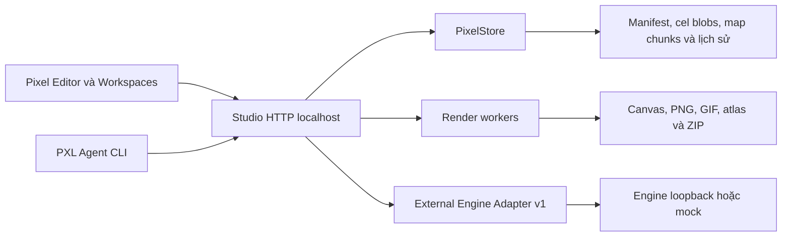

# Kiến trúc LumaSprite Studio

| Thành phần | Trách nhiệm và điểm vào |
|---|---|
| Frontend | Vite build `studio/index.html` và `studio/legacy.html`. `studio/pixel/app.ts` nối canvas, Timeline, layer, palette, Asset Library và các workspace. Session quản lý revision, bản nháp, undo/redo và cel tải theo yêu cầu. |
| Backend Studio | `bin/pxl.js` chọn source TS hoặc `dist`. `src/node/cli.ts` nạp Studio và Agent theo lệnh. `server.ts` bind loopback, phục vụ UI, phát sự kiện và điều phối API. `pixel-api.ts` nối lưu trữ, edit, render, export và proposal. |
| PixelStore | `pixel-store.ts` xác minh tài liệu RGBA v2, đường dẫn, revision và blob. Cel/resource dùng hash nội dung. Lưu và restore kiểm dữ liệu trước khi ghi. Route đọc cel xác minh manifest, revision và blob đích. |
| Render và export | `src/core` cung cấp hình, palette, compositing, font và PXL DSL. `runner.ts` và worker Studio dựng preview/export. Kiểm tra PXL trước khi thực thi. `zip.ts`, `png.ts`, `gif.ts` và các worker đóng gói định dạng cục bộ. |
| Tilemap và Production | `map-commands.ts` quản lý tileset, collision và chunk. `production-workspace.ts` nối Library, Style và Scene. `production-worker.ts` xác thực version, stamp, timing, pivot, map rồi dựng preview hoặc ZIP. |
| External Engine Adapter v1 | `src/studio/engine-adapter.ts`, `external-engine-api.ts` và `external-engine-transport.ts` đàm phán capability, gửi job, kiểm raster, kiểm digest và revision lúc áp dụng. Studio giữ lịch sử và quyền quyết định. |
| Agent API và CLI | `agent-contract.ts`, `agent-api.ts` và `agent-cli.ts` chia sẻ hợp đồng JSON v1. Agent đọc project đã lưu, làm export bằng worker và chỉ ghi với token, payload hợp lệ và expected revision. |
| Legacy và thử nghiệm | Core PXL, Legacy Studio, Fast, P0, PoseSpec, Quality, rig và clip vẫn có người dùng hoặc hồi quy. Các điểm vào này giữ schema project đã lưu và đường phục hồi tương thích. |

## Dữ liệu và quyền sở hữu

- **Legacy schema 1** lưu dự án mã PXL và dùng `/legacy.html`. **Pixel schema 2** lưu tài liệu native, cel RGBA, metadata và resource. Production extension v1 thêm collection, profile, phiên bản và Scene vào tài liệu Pixel. `pxl.project.json` cùng `.pxl/` cần được sao lưu chung.
- Thao tác Editor đi từ session tới API kèm revision. Restore sinh revision mới. Kết quả engine đến muộn hoặc nguồn bị đổi cần được xử lý trước khi áp dụng. PNG, GIF, strip/atlas và map ZIP là định dạng trao đổi.
- Studio sở hữu workflow, renderer cục bộ, export và dữ liệu. Engine độc lập sở hữu nghiên cứu sinh hình. Hợp đồng raster v1 là biên tích hợp.

[Frontend](studio/pixel/app.ts) · [Máy chủ](src/node/studio/server.ts) · [PixelStore](src/node/studio/pixel-store.ts) · [Worker Production](src/node/studio/production-worker.ts) · [Engine Adapter](src/studio/engine-adapter.ts) · [Hợp đồng Agent](src/studio/agent-contract.ts)
